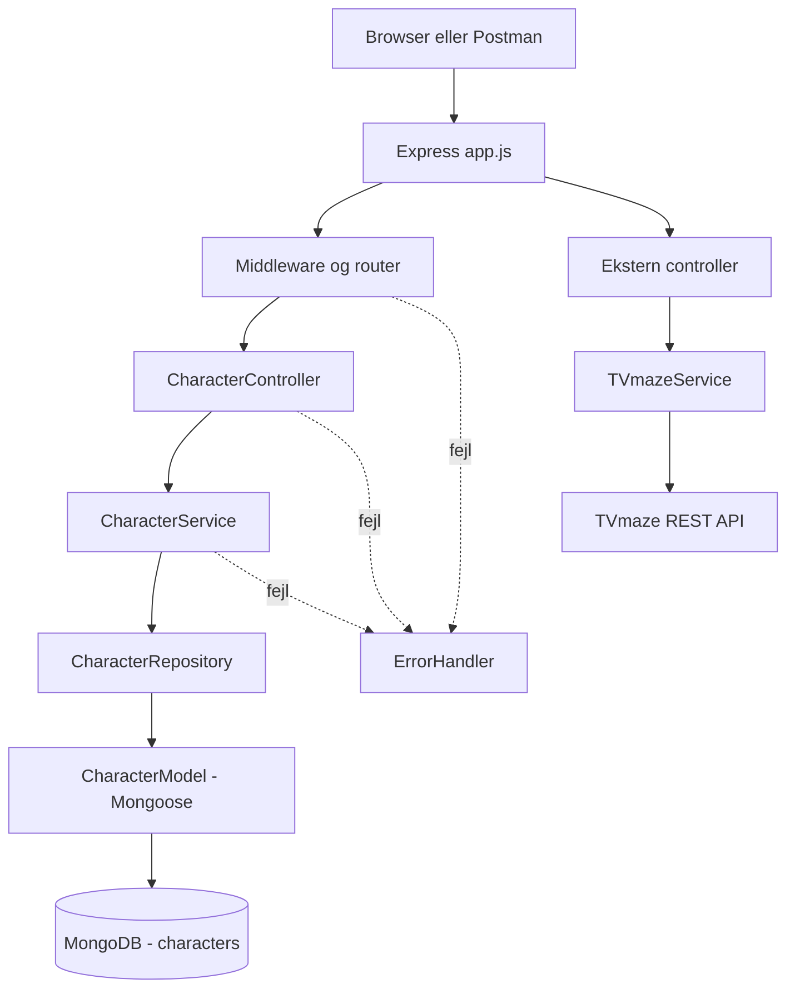

# Arkitektur og ansvar

Alle datareturneringer går tilbage via controlleren som JSON. Ved fejl sendes et passende HTTP-svar fra errorHandler. **TVmaze-data gemmes ikke i MongoDB.**

## Ansvarsregler

| Lag | Har ansvar for | Må ikke gøre |
| --- | --- | --- |
| Router | HTTP-metode og URL | Databasequeries |
| Middleware | Validering af request | Forretningslogik |
| Controller | `req`, `res`, statuskoder | Kalde Mongoose |
| Service | Forretningsregler, koordinering | Bruge `req`, `res` |
| Repository | Læse/skrive via Mongoose | Afgøre HTTP-status |
| Model | Schema og DB-validering | Håndtere HTTP |
| Integrationsservice | HTTP-kald til TVmaze | Gemme direkte i MongoDB |

## Følg en request

`POST /api/characters` → `characterRoutes.js` → `validateCharacter.js` → `characterController.create()` → `characterService.create()` → `characterRepository.create()` → `Character.create()` → MongoDB → JSON med status 201.

Forklar hvert trin med din egen formulering. Hvilken fil ville du ændre, hvis en karakter ikke må gemmes med navnet `Unknown`? (En forretningsregel hører hjemme i service-laget.)
